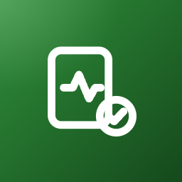
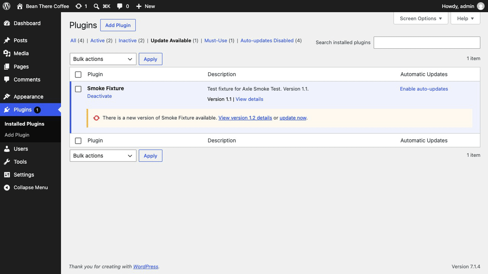
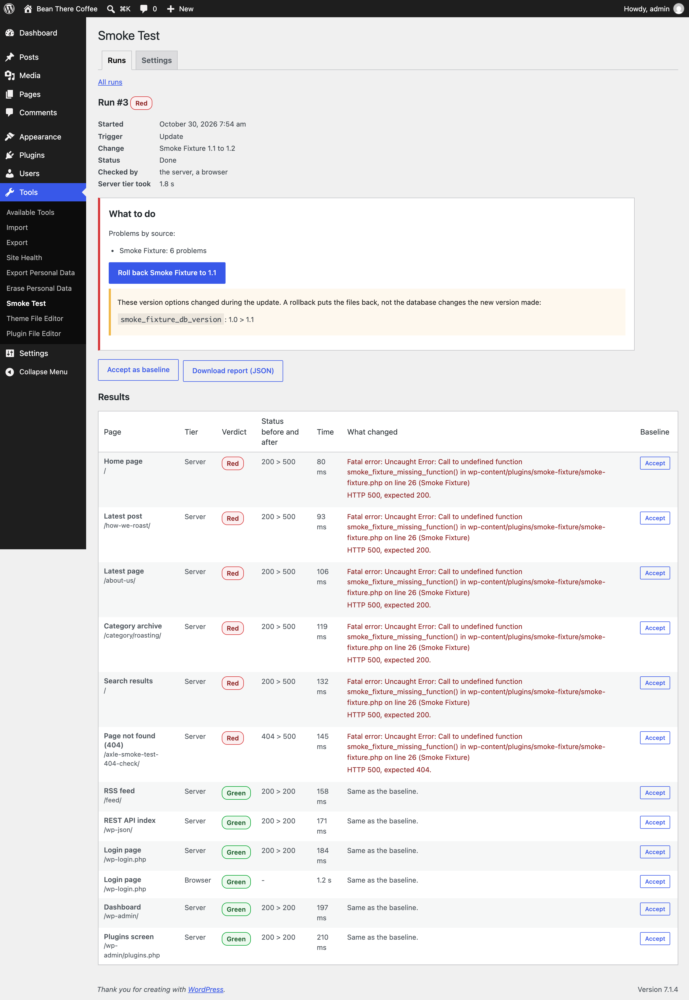
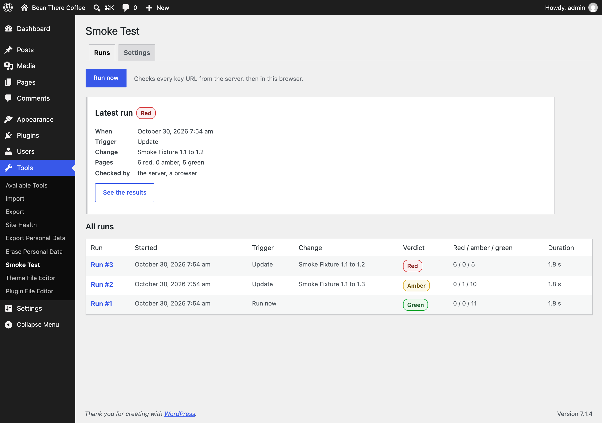
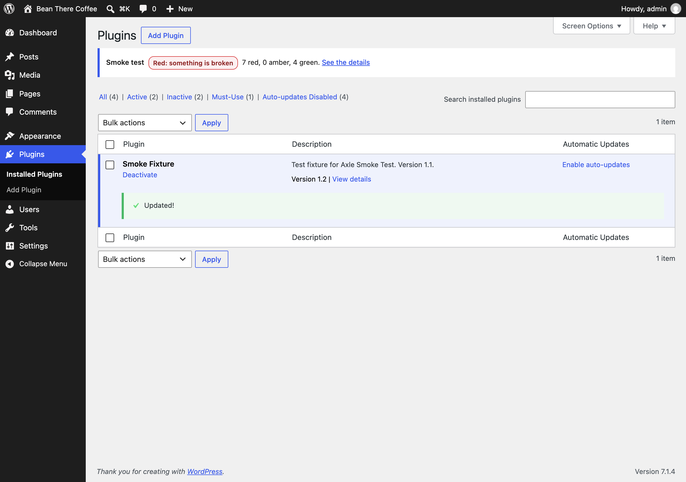
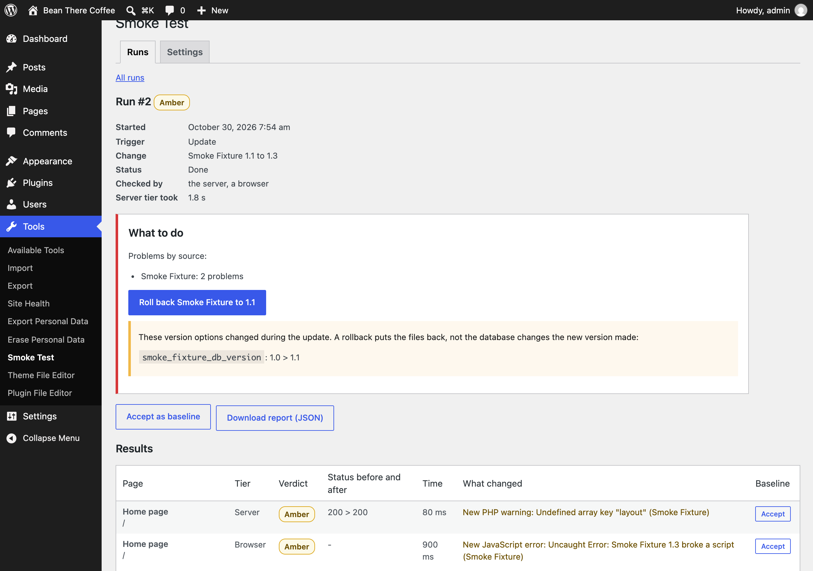
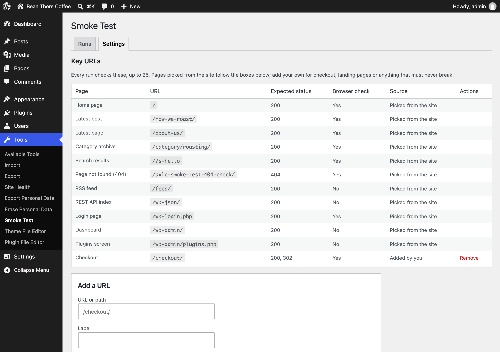

<p align="center"></p>

<h1 align="center">Axle Smoke Test</h1>

<p align="center">
  <a href="https://playground.wordpress.net/?blueprint-url=https://raw.githubusercontent.com/aryanjasala/axle-smoke-test/main/blueprint.json"></a>
  <a href="https://github.com/aryanjasala/axle-smoke-test/releases/latest"></a>
  
  
  <a href="LICENSE.md"></a>
  <br>
  <a href="https://github.com/aryanjasala/axle-smoke-test/actions/workflows/phpcs.yml"></a>
  <a href="https://github.com/aryanjasala/axle-smoke-test/actions/workflows/phpstan.yml"></a>
  <a href="https://github.com/aryanjasala/axle-smoke-test/actions/workflows/unit-tests.yml"></a>
  <a href="https://github.com/aryanjasala/axle-smoke-test/actions/workflows/e2e-tests.yml"></a>
  <a href="https://github.com/aryanjasala/axle-smoke-test/actions/workflows/plugin-check.yml"></a>
</p>

<p align="center">Checks your key pages after every update or deploy, finds what broke and which plugin broke it, and rolls it back.</p>

<p align="center">
  
</p>

---

An update or a deploy breaks checkout, wp-admin or a page template, and the first person to notice is a customer. WordPress itself only checks the home page for a fatal error, and only after automatic updates. The tools that do more need a SaaS account and a site the public can reach. Axle Smoke Test checks your key pages from your own server right after every change, tells you what broke and which plugin or theme broke it, and rolls it back. Nothing leaves your site.

> [!NOTE]
> Free and open source under the GPL. No pro version, no upsells, no ads in wp-admin, no tracking. And it stays that way.
>
> Part of Axle by AryanX, a family of plugins for running WordPress sites safely.

## Features

- **Runs by itself** after plugin, theme, core and translation updates (manual or automatic), plugin installs and activations, theme switches and deploys (a five-minute code fingerprint check). Also on demand, from WP-CLI with an exit code for pipelines, the REST API and abilities
- **Server checks** of each key URL: expected status, fatal errors (core's own scrape check), PHP warnings, the critical error page, blank pages, missing scripts and stylesheets, landmarks and text changes. wp-admin screens open as a signed-in admin with a single-use, 60-second login
- **Browser checks** in a hidden frame of an admin's browser: JavaScript errors, failed files and images, and where the landmarks sit. Cron runs wait for the next admin page view
- **Red, amber, green** against a baseline, with every error blamed on the plugin or theme it came from. Accept a run as the new baseline after a redesign
- **Key URLs** picked from the site (home, latest post and page, a category, search, a 404, feed, REST API, login, dashboard, Plugins screen, WooCommerce pages) plus your own, each with its expected status
- **Rollback**: every plugin and theme is zipped before its update. One click (or WP-CLI, or auto rollback, off by default) puts it back, clears OPcache and checks again. Version options that changed are listed, since the database is not undone
- **Alerts** by email, webhook (JSON or Slack), admin notice and Site Health, rate-limited per page
- **Works with the Axle family**: Activity Log with Undo logs runs, Update Rehearsal is suggested for the next update, Axle Read-Only Mode blocks rollbacks during a freeze
- **An external worker** contract for real screenshots from your own machine or CI, with a reference Playwright script
- **Privacy** export and erase, no page contents stored, secrets encrypted, **WP-CLI** for everything, abilities, and multisite

## Install

1. Download `axle-smoke-test.zip` from the [latest release](https://github.com/aryanjasala/axle-smoke-test/releases/latest).
2. In WordPress, go to **Plugins > Add New Plugin > Upload Plugin**, choose the zip and activate it.

Or with WP-CLI:

```sh
wp plugin install https://github.com/aryanjasala/axle-smoke-test/releases/latest/download/axle-smoke-test.zip --activate
```

Needs WordPress 6.6+ and PHP 7.4+. To try it first, the **Try in WordPress Playground** badge opens a throwaway WordPress in your browser with the plugin and some demo content.

## Quick look

Update a plugin from the Plugins screen and the check runs right there. Or from a deploy pipeline:

```sh
wp plugin update --all
wp axle-smoke-test run --reason="Deploy 4f2a9c1"
# url          tier    status  ms   verdict  reasons
# home         server  500     81   red      Fatal error: Uncaught Error: Call to undefined function ... [plugin:coffee-shop]
# Verdict: red (done)
# exit code 1

wp axle-smoke-test rollback 12 --yes
# Success: Rolled back Coffee Shop to 2.4.0. Run #13 after the rollback: green.
```

## Screenshots

<table>
  <tr>
    <td width="50%" valign="top"><br><sub>A red run after an update: the fatal error, the plugin that caused it, and the one-click rollback</sub></td>
    <td width="50%" valign="top"><br><sub>The latest run and every run before it</sub></td>
  </tr>
  <tr>
    <td width="50%" valign="top"><br><sub>Right after an update on the Plugins screen, the check runs and shows the verdict</sub></td>
    <td width="50%" valign="top"><br><sub>An amber run: a new JavaScript error, found by the check in your browser</sub></td>
  </tr>
  <tr>
    <td width="50%" valign="top"><br><sub>Settings: key URLs, what to check and how to be told</sub></td>
  </tr>
</table>

## Documentation

| Doc | What it covers |
| --- | --- |
| [Reference](docs/REFERENCE.md) | Tiers, triggers, key URLs, verdicts, baselines, rollback, alerts, hooks, abilities, REST API and the worker, WP-CLI, security and data |
| [Development](docs/DEVELOPMENT.md) | Local setup, commands and tests |
| [Contributing](docs/CONTRIBUTING.md) | Pull requests, required checks and PR titles |
| [Releasing](docs/RELEASING.md) | How merged pull requests become releases |
| [Security](docs/SECURITY.md) | Reporting a vulnerability |
| [readme.txt](readme.txt) | What WordPress.org shows, with the FAQ and changelog |

## Project structure

```
axle-smoke-test.php      plugin header and PSR-4 autoloader
early.php                loaded by the optional early must-use plugin
src/
├── Plugin.php           creates the services
├── Schema.php           tables, schedules, activation
├── Settings.php         settings, secrets, the capability
├── Urls.php             key URLs
├── Checker.php          the server tier
├── Analyzer.php         HTML hash, text, landmarks, assets
├── ErrorCollector.php   PHP errors during a loopback
├── DebugLog.php         new lines in debug.log
├── AdminSession.php     the single-use wp-admin login
├── Verdict.php          red, amber, green
├── Attribution.php      which plugin or theme
├── Runner.php           queue, run, baseline
├── Runs.php             the two tables
├── Triggers.php         updates, installs, theme switches, deploys
├── Fingerprint.php      the deploy check
├── Backups.php          zips before updates
├── Rollback.php         restore, OPcache, auto rollback
├── Alerts.php           email, webhook, notice
├── Family.php           the other Axle plugins
├── Browser/Injector.php the browser tier's collector
├── Rest/Controller.php  REST API and worker contract
├── Admin/               Tools > Smoke Test, the panel, Network Admin
├── Health/SiteHealth.php
├── Abilities.php
├── Privacy.php
└── Cli/Command.php      wp axle-smoke-test
assets/                  runner, collector, shared logic, styles
docs/worker/             reference Playwright worker (not in the zip)
tests/
├── Unit/                PHPUnit
├── js/                  Node tests for the shared logic
└── e2e/                 Playwright specs, fixtures and the Docker site
.wordpress-org/          screenshots
```

## More free plugins

Small plugins that each fill one gap in WordPress, all free with no pro version:

| | Plugin | What it does |
| --- | --- | --- |
|  | [Page Template Usage](https://github.com/aryanjasala/page-template-usage) | See which template every page uses, and fix the pages on a missing template |
|  | [Staging Guard](https://github.com/aryanjasala/staging-guard) | Stops staging copies from emailing real people or getting indexed |
|  | [Category & Tag Trash](https://github.com/aryanjasala/category-tag-trash) | A trash for categories, tags and custom terms, with undo and full restore |
|  | [Axle Read-Only Mode](https://github.com/aryanjasala/axle-read-only-mode) | Read-only mode for WordPress during migrations and deploys |
|  | [Restore Blocks from Revisions](https://github.com/aryanjasala/restore-blocks-from-revisions) | Restore a single block from an old revision, not the whole post |
|  | [Activity Log with Undo](https://github.com/aryanjasala/activity-log-with-undo) | An activity log where every change you can reverse has an Undo button |
|  | [Agent Governance](https://github.com/aryanjasala/agent-governance) | Hold risky AI agent calls for approval, preview what they change, and roll back a session |
|  | [Block Doctor](https://github.com/aryanjasala/block-doctor) | Scan the whole site for invalid and broken blocks and fix them in bulk, with undo |
|  | [Block Theme Ops](https://github.com/aryanjasala/block-theme-ops) | Find Site Editor changes that override your theme files, see the diff, reset them or send them to Git |
|  | [Role Right-Sizer](https://github.com/aryanjasala/role-right-sizer) | Recommends the smallest role each user needs, from what they actually do |
|  | [Update Rehearsal](https://github.com/aryanjasala/update-rehearsal) | Try plugin, theme, core and PHP updates on a disposable copy of your site in WordPress Playground first |
|  | [User Session Manager](https://github.com/aryanjasala/user-session-manager) | See every device signed in, sign out one, and limit sessions per role |

## License

Copyright Aryan Jasala. Licensed under [GPL-2.0-or-later](LICENSE.md).
